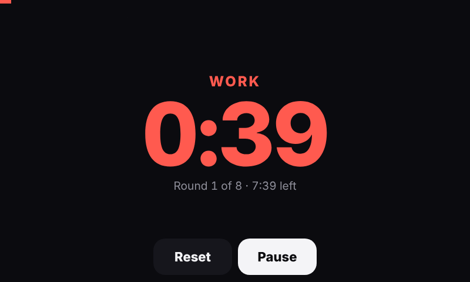

# PlexPie

Turn a Raspberry Pi with a touchscreen and a DAC into a one-screen music player:
**Plexamp**, **AirPlay 2**, **Spotify Connect**, the **Apple Music** web player and **Music Assistant**, all
on one launcher and all controllable from **Home Assistant**.

> **New to Raspberry Pi?** Follow the **[step-by-step guide](docs/INSTALL.md)**: shopping list,
> wiring your DAC to a receiver or speakers, preparing the memory card, installing, and first use.
> No Linux knowledge needed.

<p>
  
  
</p>
<p>
  
  
</p>

| Source | What it is |
|---|---|
| **Plexamp** | Plexamp headless with its full touch interface; also controllable from the Plexamp app on your phone. Lossless (FLAC/hi-res) to your DAC |
| **AirPlay** | AirPlay 2 receiver (shairport-sync). The screen shows cover art, track and the stream format |
| **Spotify** | Spotify Connect receiver (go-librespot): pick the Pi in the Spotify app (Premium). Optional Spotify web player on the screen |
| **Apple Music** | music.apple.com on the screen (Chromium + Widevine), zoomed so it shows the full desktop layout |
| **Music Assistant** | The Pi becomes a Music Assistant player (Squeezelite), and MA's own interface opens on the screen |
| **Timer** | Workout timer: intervals (work / rest / rounds), countdown and stopwatch, with big digits and beeps |
| **Home** | The launcher: now playing, volume, pause all, screen off, and your Home Assistant buttons |

How it behaves:

- **One source at a time.** Starting one source pauses the others, and the screen switches to the app that started playing.
- **Swipe home.** Swipe right from the left edge, or down from the top edge, to get back to the launcher from any app.
- **On-screen keyboard.** A keyboard slides up when you tap a text field (sign-ins, search), and the app shrinks to fit above it.
- **Screen sleep.** The screen sleeps when nothing is playing. The first tap only wakes it.
- **Self-healing.** A crashed app is restarted automatically.
- **Settings screen.** The gear on the launcher opens Settings: switch apps on and off, see which accounts are signed in, set the screen sleep, Home Assistant and Music Assistant. The same page opens on your phone at `http://<pi-address>:8080/settings`, protected by a PIN shown on the player.

## What you need

- **Raspberry Pi 4 or 5** with **Raspberry Pi OS 64-bit** (Bookworm or Trixie, Lite or Desktop).
- **A touchscreen**, any size or shape: the launcher picks its grid for the screen (one row on wide screens, a 2–3 row grid of near-square tiles on square or portrait screens) and scales up on big displays.
- **Audio output:** a USB DAC, which is picked automatically, or HDMI / the headphone jack.
- **Accounts:**
  - a **Plex** account for Plexamp
  - an **Apple Music** subscription, only for the web player
  - **Spotify Premium**, only for Spotify Connect
  - optional: **Home Assistant** with an MQTT broker (e.g. the Mosquitto add-on), and a **Music Assistant** server

> PlexPie takes over the Pi's screen: the desktop is replaced by the music launcher.
> The installer backs up what it changes, and `rollback.sh` puts it back.

## Install

The [step-by-step guide](docs/INSTALL.md) walks through everything from an empty Pi. The short version, on the Pi, logged in as your normal user (not root):

```bash
curl -fsSL https://raw.githubusercontent.com/ROGUEONE-SZ/plexamp-raspberry-pi-install/main/get.sh | bash
```

This downloads PlexPie to `~/plexpie`, then runs a short setup wizard that asks for:

- a player name
- which sources you want
- your Home Assistant / MQTT details (optional)
- how long until the screen sleeps

After that it installs everything. The first install takes about 15 minutes, mostly building AirPlay 2.

Partway through, it asks you to link Plexamp to your Plex account. Open
[plex.tv/claim](https://plex.tv/claim) on any device, copy the code, and paste it in.

When it finishes, the touchscreen restarts into the launcher. Sign in to Apple Music and
Music Assistant on the screen the first time you open them.

<details>
<summary>Prefer to do it by hand?</summary>

```bash
git clone https://github.com/ROGUEONE-SZ/plexamp-raspberry-pi-install ~/plexpie
cd ~/plexpie
bash configure.sh          # or: cp plexpie.conf.example plexpie.conf && nano plexpie.conf
sudo bash install.sh
```
</details>

## Settings

Tap the gear on the launcher, or open `http://<pi-address>:8080/settings` on your phone. The address and PIN are on the player's Settings page under **Phone access**.

 

- **Apps:** turn Apple Music, AirPlay, Spotify Connect, the Spotify web player and Music Assistant on or off. The change is instant: everything is installed, and players that are off are stopped.
- **Accounts:** shows whether each service is linked, with sign-out for the web players. PlexPie never stores your passwords; each service signs in on its own page and keeps a token.
- **Updates:** checks twice a day for Raspberry Pi OS and PlexPie updates; **Update now** installs both, and tells you if a restart is needed. Home Assistant also gets an update entity with an Install button.
- **Network:** Wi-Fi on/off, current network, scan and join (the password goes to NetworkManager, not PlexPie).
- **Screen, Home Assistant, Music Assistant, phone access, restart and reboot.**

From a phone, only the Settings page is reachable, and only with the PIN. Five wrong tries pause logins for a minute. A phone stays signed in for a year (renewed each visit); **New PIN** signs every phone out.

To keep it on your home screen: open the page, then **Share → Add to Home Screen** (iPhone) or **⋮ → Add to Home screen** (Android). It opens like an app.

## Change settings, update, uninstall

| | |
|---|---|
| Change your answers | The Settings page, or `bash ~/plexpie/configure.sh && sudo bash ~/plexpie/install.sh` |
| Update to the latest version | `cd ~/plexpie && git pull && sudo bash install.sh` |
| Undo everything | `sudo bash ~/plexpie/rollback.sh`, then reboot |

All settings live in `~/plexpie/plexpie.conf`, with a comment on each line. That file holds
your MQTT password, so it's never committed to git. A few you might want:

| Setting | What it does |
|---|---|
| `SCREEN_OFF_AFTER_SECS` | Idle time before the screen sleeps (`0` = never) |
| `AUTO_SHOW_SOURCES` | Which sources bring their app to the screen when they start |
| `APPLE_MUSIC_ZOOM` | Apple Music zoom in percent (`100` = normal) |
| `DAC_MATCH` | Which audio device to prefer (default: any USB DAC) |
| `CHROMIUM_SCALE` | Zoom for all apps, for screens that aren't 800×480 |
| `SWIPE_HOME`, `TOUCH_ROTATE` | Edge swipes to go home; rotation if the screen is mounted rotated |

## Home Assistant

With MQTT set up, the Pi appears automatically under **Settings → Devices** with these entities:

- **Source:** what's on the screen. Change it to switch apps.
- **Now playing:** source, title, artist, album, and the AirPlay format.
- **Playing:** a binary sensor.
- **Screen:** an on/off switch, plus **Screen brightness**.
- **Volume.**
- **Buttons:** **Pause all**, **Restart screen**, **Reboot**.
- **AirPlay artwork:** an image entity.
- **Diagnostics:** CPU temperature, and whether Music Assistant is reachable.
- **Screen alert:** a notify entity that puts a message on the screen with a chime.
- **Launcher buttons:** one switch per name in **Settings → Home Assistant → Launcher buttons** (for example `Gym lights`). Tapping the button flips the switch; your automations do the rest, and can flip it back to keep it in sync.

### Screen alerts (doorbell, timers, anything)

Publish to `plexpie/<hostname>/alert/set` to show a message for a while, with a chime, over whatever is playing (music keeps playing and isn't paused). A picture can be any URL, or a Home Assistant camera:

```yaml
action: mqtt.publish
data:
  topic: plexpie/szplexpie/alert/set
  payload: >
    {{ {"title": "Front door", "message": "Someone is at the door", "seconds": 30,
        "image": state_attr("camera.front_door", "entity_picture")} | tojson }}
```

`image` paths starting with `/` are loaded from Home Assistant (`HA_URL`, or `http://HA_HOST:8123`). Tap the alert to close it; it goes back to the app that was on screen.

Example: turn your amplifier on when anything plays.

```yaml
triggers:
  - trigger: state
    entity_id: binary_sensor.<your_pi>_playing
    to: "on"
actions:
  - action: media_player.turn_on
    target:
      entity_id: media_player.<your_amplifier>
```

For full Plexamp transport control in Home Assistant, also add the official **Plex** integration.

## Music Assistant

In Music Assistant, open **Settings → Providers** and enable the **Squeezelite** player
provider. Your Pi then shows up as a player under the name you chose. If MA runs on a
different subnet from the Pi, set its address in the wizard. When MA is off, its tile greys
out, and the Pi reconnects by itself when MA comes back.

## Good to know

- **Spotify Connect** uses an unofficial protocol: if Spotify changes something, it may stop working until go-librespot is updated (`UPDATE_SPOTIFY=1 sudo -E bash install.sh`). Quality is up to 320 kbps.
- **AirPlay from Apple Music is lossy** (AAC, about 256 kbps), even when your phone shows
  "Lossless". The iPhone converts the stream before sending it, and the AirPlay screen shows
  the actual format. For lossless, use Plexamp with your own FLAC files.
- **The Apple Music web player** needs Widevine. Raspberry Pi OS includes it; plain Debian doesn't.
- **AirPlay doesn't show up on your phone?** The phone and the Pi are probably on different
  subnets. Enable an mDNS repeater (Avahi) on your router.

## Troubleshooting

| Problem | Where to look |
|---|---|
| Full report (services, audio, logs, test tone) | `bash ~/plexpie/tools/diagnose.sh` |
| Launcher, screen or Home Assistant | `journalctl -u plexpie -f` |
| Chromium, keyboard | `~/.local/state/plexpie/session.log` |
| Swipe home doesn't work | `journalctl -u plexpie \| grep -i touch` (set `TOUCH_ROTATE` if your screen is mounted rotated) |
| AirPlay | `journalctl -u plexpie-airplay -f` |
| Music Assistant player | `journalctl -u plexpie-squeezelite -f` |
| Spotify Connect | `journalctl -u plexpie-spotify -f` |
| Updates | `/var/log/plexpie-update.log` |
| Plexamp | `journalctl -u plexamp -f` |
| Audio devices | `wpctl status` |
| Plexamp keeps spinning | Remove `~/.local/share/Plexamp/Settings/%40Plexamp%3Adiscovery%3Ahubs` and run `sudo systemctl restart plexamp` |
| Plex servers unreachable behind pfSense/OPNsense | DNS rebinding protection: allow `plex.direct` (`private-domain: "plex.direct"` in the DNS Resolver) |

## How it fits together

```
get.sh / configure.sh / install.sh / rollback.sh
files/plexpied.py           control daemon: launcher API, app tabs, swipe home, screen, auto-pause, Home Assistant
files/plexpie-overlay.py    on-screen keyboard and touch-to-wake
files/plexpie-session       X session: overlay + Chromium kiosk
files/www/                  launcher, now-playing (AirPlay/Spotify) and Settings screens
files/systemd/              services (plexpie, AirPlay, Spotify, Squeezelite, Plexamp)
files/audio/                PipeWire/ALSA: every source shares the DAC
files/shairport-sync.conf   AirPlay receiver settings
tools/diagnose.sh           read-only troubleshooting report
```

PlexPie glues together other people's excellent work:
[Plexamp](https://www.plex.tv/plexamp/),
[shairport-sync](https://github.com/mikebrady/shairport-sync) and nqptp,
[Squeezelite](https://github.com/ralph-irving/squeezelite),
[go-librespot](https://github.com/devgianlu/go-librespot),
[Music Assistant](https://music-assistant.io), PipeWire and Chromium.
Plexamp, Apple Music, AirPlay and Spotify are trademarks of their owners; this project isn't
affiliated with Plex, Apple or Spotify.

## License

**Free for personal, non-commercial use** under the [PolyForm Noncommercial License 1.0.0](LICENSE.md):
use it at home, change it, share it with friends, learn from it.

**Commercial use is not allowed without permission.** That includes selling devices or kits
with PlexPie on them, offering it as a paid service, or building it into a product. If you'd
like to do that, open an issue to ask about a commercial license.

PlexPie installs other projects (Plexamp, shairport-sync, go-librespot, Squeezelite, Chromium
and more) from their official sources. Those keep their own licenses and terms.
