# PlexPie

Turn a Raspberry Pi with a touchscreen and a DAC into a one-screen music player:
**Plexamp**, **AirPlay 2**, **Spotify Connect**, the **Apple Music** web player, **Music Assistant** and **Caldera Music**, all
on one launcher and all controllable from **Home Assistant**.

> **New to Raspberry Pi?** Follow the **[step-by-step guide](docs/INSTALL.md)**: shopping list,
> wiring your DAC to a receiver or speakers, preparing the memory card, installing, and first use.
> No Linux knowledge needed.

<p>
  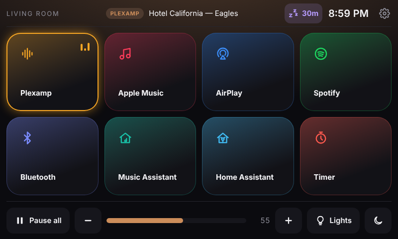
  
</p>
<p>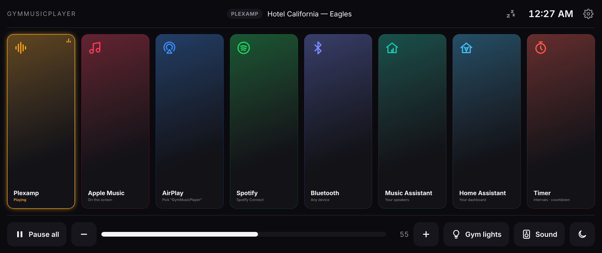</p>

<p>
  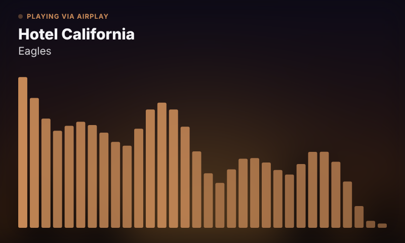
  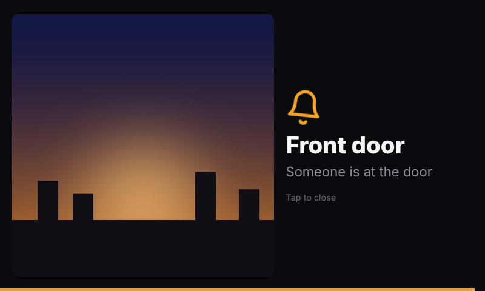
</p>

| Source | What it is |
|---|---|
| **Plexamp** | Plexamp headless with its full touch interface; also controllable from the Plexamp app on your phone or tablet. Lossless (FLAC/hi-res) to your DAC |
| **AirPlay** | AirPlay 2 receiver (shairport-sync). The screen shows cover art, track and the stream format |
| **Spotify** | Spotify Connect receiver (go-librespot): pick the Pi in the Spotify app (Premium). Optional Spotify web player on the screen |
| **Bluetooth** | Any phone, tablet or computer can play to it: tap **Pair a device**, then pick the player in its Bluetooth settings |
| **Apple Music** | music.apple.com on the screen (Chromium + Widevine), zoomed so it shows the full desktop layout |
| **Music Assistant** | The Pi becomes a Music Assistant player (Squeezelite), and MA's own interface opens on the screen |
| **Caldera** | Optional [Caldera Music](https://caldera.homes/music/headless/) (Plex Labs): the Pi joins your other Caldera speakers for multi-room, in sync, from Plexamp's speaker list. Shares the DAC with the other apps |
| **Timer** | Workout timer: intervals (work / rest / rounds), countdown and stopwatch, with big digits and beeps |
| **Home** | The launcher: now playing, volume, pause all, screen off, and your Home Assistant buttons |

How it behaves:

- **One source at a time.** Starting one source pauses the others, and the screen switches to the app that started playing.
- **Swipe home.** Swipe right from the left edge, or down from the top edge, to get back to the launcher from any app. With a mouse, keyboard or screen sharing: a small Home tab on the left edge, the Home key (or Esc twice), or the mouse's Back button.
- **On-screen keyboard.** A keyboard slides up when you tap a text field (sign-ins, search), and the app shrinks to fit above it.
- **Screen sleep.** The screen sleeps when nothing is playing. The first tap only wakes it.
- **Self-healing.** A crashed app is restarted automatically.
- **Equalizer and room correction.** Presets (less boomy bass, loudness, clearer voices…), a 5-band custom EQ, or paste filters from AutoEQ (headphones) or REW (your room, see the [room-correction guide](docs/ROOM-CORRECTION.md)). Off by default, so lossless music plays untouched.
- **Visualizer.** Spectrum bars or VU meters on the AirPlay, Spotify and Bluetooth screens; tap the cover for full screen.
- **Album-art colors.** The screens take their accent color from the cover that's playing.
- **Night dimming and auto-brightness.** Dim on a schedule, or follow a Home Assistant light sensor.
- **Home Assistant tile.** A Home Assistant dashboard on the screen; tip: make a small one just for this screen and set it under Settings → Configuration → Home Assistant.
- **Optional knob and power button.** A $3 rotary knob for volume and play/pause, and a push button to shut down and start ([wiring](docs/gpio.svg)).
- **Sleep timer.** The zᶻ button next to the clock stops the music after 15 to 90 minutes, fading out over the last minute.
- **Backup and restore.** Send all your settings as one file to a registered phone, tablet or computer (scan a QR code on the screen), and restore them on a new memory card.
- **Setup guides built in.** Plain-English, step-by-step instructions for every app, on the player itself (offline, always matching your version). Save one as a PDF, share it, or download the [full setup guide (PDF)](docs/PlexPie-Setup-Guide.pdf).
- **Power-cut protection.** An optional read-only mode, so pulling the plug can't damage the memory card.
- **Screen sharing.** See and use the player's screen from a Mac (Screen Sharing), iPad or iPhone (RealVNC Viewer); off by default, home network only, password = your PIN.
- **Works with a mouse, keyboard or any monitor.** A Home tab appears for a mouse or screen sharing, the Home key or Esc twice go home, the pointer hides for touch, and the screen fills anything from a 7" touchscreen to an ultrawide.
- **Exit to the desktop.** Settings › System › Exit switches to the Raspberry Pi desktop (or the command line on Lite) until the next restart; the Back to PlexPie icon or `plexpie` brings it back.
- **Self-checks and fixes.** Updates with real progress, a blank Plexamp screen reloads itself, the player notices when its network address changes, and read-only reports (`tools/diag.sh`) for troubleshooting.
- **Settings screen.** The gear on the launcher opens Settings, organised by category like an iPad: Configuration (every app and account), Screen, Sound, Network, Updates, Remote access, Backup, Setup guides and System. The same page opens on any phone, tablet or computer at `http://<pi-address>:8080/settings`, protected by a PIN shown on the player.

## Before you build: what to expect

PlexPie is a free hobby project. I built it for the home gym in my basement and shared it because
it turned out nicer than I expected. Please read this before you start:

- **Tested hardware:** Raspberry Pi 4 or 5, the official 7" touchscreen or an HDMI touchscreen, and a
  USB DAC. That's what I own and test every release on. Other boards (Pi 3, Pi Zero), SPI screens that
  need their own drivers, and DAC HATs that sit on the pins may work, but they're community-supported.
- **Apps change under us.** Plex, Apple, Spotify and Raspberry Pi OS update on their own schedule, and
  sometimes that breaks a tile until someone fixes it. One broken app doesn't take down the others.
- **Use at your own risk.** It's provided as-is, with no warranty. Back up your settings (Settings ›
  Backup) and keep the memory card you started from if you're nervous.
- **Getting help:** the [troubleshooting guide](docs/TROUBLESHOOTING.md) covers every problem I've hit.
  Questions, setup and network/router problems go to
  [Discussions](https://github.com/ROGUEONE-SZ/plexamp-raspberry-pi-install/discussions), where other
  builders can help. Bugs go to Issues, with the diagnostics report the form asks for.

## How this was built

PlexPie is my design: I knew exactly what I wanted for my gym,
and I built it with **[Claude](https://claude.ai)** (Anthropic's AI) writing most of the code, while I
drove the design, made the calls and tested everything on my own Pi, receiver and network.
It started as a rough Plexamp-on-a-Pi setup; one weekend I decided to turn it into something much
better. What's a better way to use AI than to make your own life a little better?

What that means for you:

- **Every feature runs on real hardware** (Raspberry Pi 4, 7" screen, SMSL DAC, Onkyo receiver, Home
  Assistant) before it's released. The bugs we found that way, and how they were fixed, are in the
  [troubleshooting guide](docs/TROUBLESHOOTING.md) and the commit history.
- **The code is plain and readable:** Python 3 and bash, no frameworks, comments that explain why. Read
  it before you run it; reviews and pull requests are welcome (see [CONTRIBUTING](CONTRIBUTING.md)).
- **No accounts, no cloud, no telemetry.** PlexPie never stores your music-service passwords, and runs
  entirely on your home network.

## What you need

- **Raspberry Pi 4 or 5** with **Raspberry Pi OS 64-bit** (Bookworm or Trixie, Lite or Desktop).
- **A touchscreen or a monitor**, any size or shape (tested on the official 7" display and a 34" ultrawide over HDMI): the launcher picks its grid for the screen (one row on wide screens, a 2–3 row grid of near-square tiles on square or portrait screens) and scales up on big displays.
- **Audio output:** a USB DAC, which is picked automatically, or HDMI / the headphone jack.
- **Accounts:**
  - a **Plex** account for Plexamp
  - an **Apple Music** subscription, only for the web player
  - **Spotify Premium**, only for Spotify Connect
  - optional: **Home Assistant** with an MQTT broker (e.g. the Mosquitto add-on), and a **Music Assistant** server

> PlexPie takes over the Pi's screen: the desktop is replaced by the music launcher.
> The installer backs up what it changes, and `rollback.sh` puts it back.

## Install

The [step-by-step guide](docs/INSTALL.md) walks through everything from an empty Pi. The short version, on the Pi, logged in as your normal user (not root):

```bash
curl -fsSL https://raw.githubusercontent.com/ROGUEONE-SZ/plexamp-raspberry-pi-install/main/get.sh | bash
```

This downloads PlexPie to `~/plexpie`, then runs a short setup wizard that asks for:

- a player name
- which sources you want
- your Home Assistant / MQTT details (optional)
- how long until the screen sleeps

After that it installs everything. The first install takes about 15 minutes, mostly building AirPlay 2.

Partway through, it asks you to link Plexamp to your Plex account. Open
[plex.tv/claim](https://plex.tv/claim) on any device, copy the code, and paste it in.

When it finishes, the touchscreen restarts into the launcher. Sign in to Apple Music and
Music Assistant on the screen the first time you open them.

<details>
<summary>Prefer to do it by hand?</summary>

```bash
git clone https://github.com/ROGUEONE-SZ/plexamp-raspberry-pi-install ~/plexpie
cd ~/plexpie
bash configure.sh          # or: cp plexpie.conf.example plexpie.conf && nano plexpie.conf
sudo bash install.sh
```
</details>

## Settings

Tap the gear on the launcher, or open `http://<pi-address>:8080/settings` on any phone, tablet or computer. The address, a QR code and the PIN are on the player under **Settings › Remote access**.

Settings is laid out like an iPad: categories on the left, details on the right (on a phone, tap a category and use **‹ Settings** to go back). Nothing slides or swipes; **Done** returns to the home screen, and **Save** appears only when you've changed something.

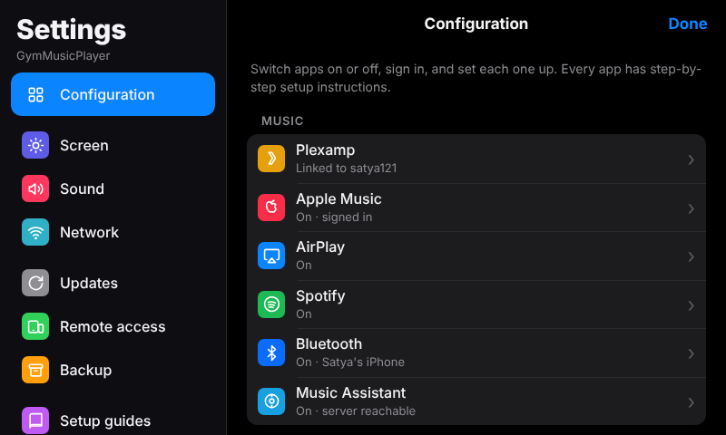 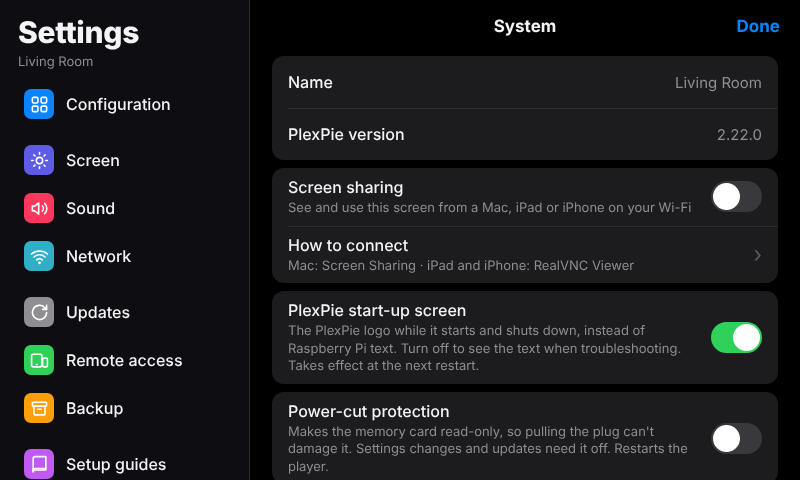 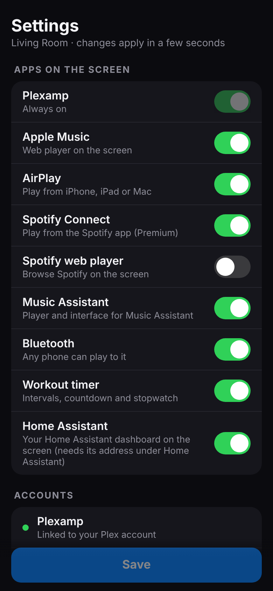

<p>
  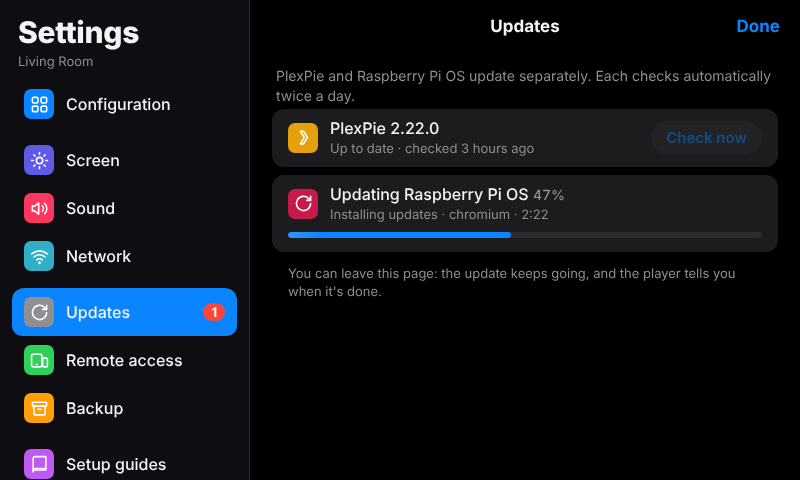
  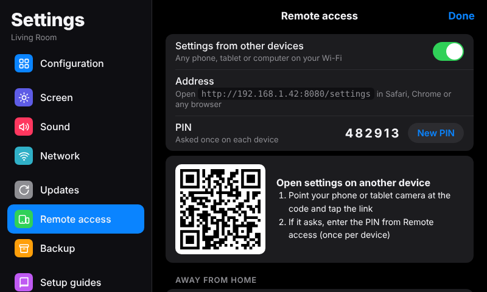
</p>
<p>
  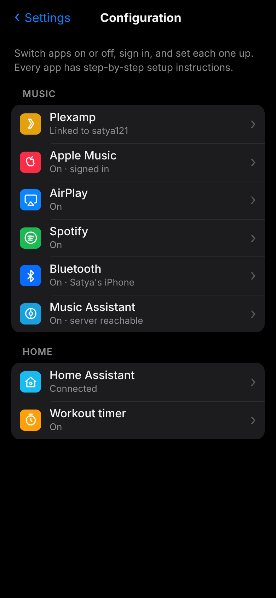
  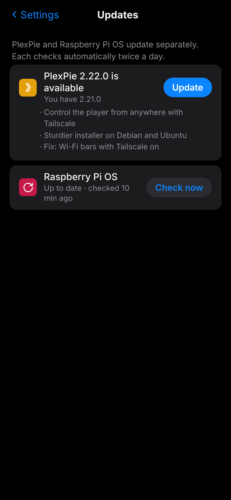
  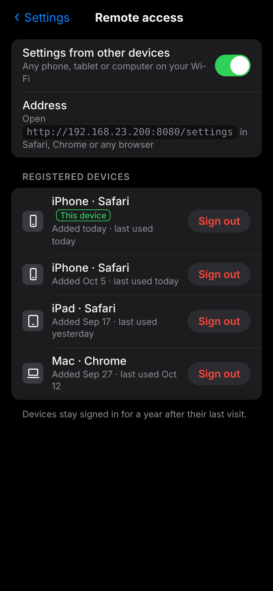
  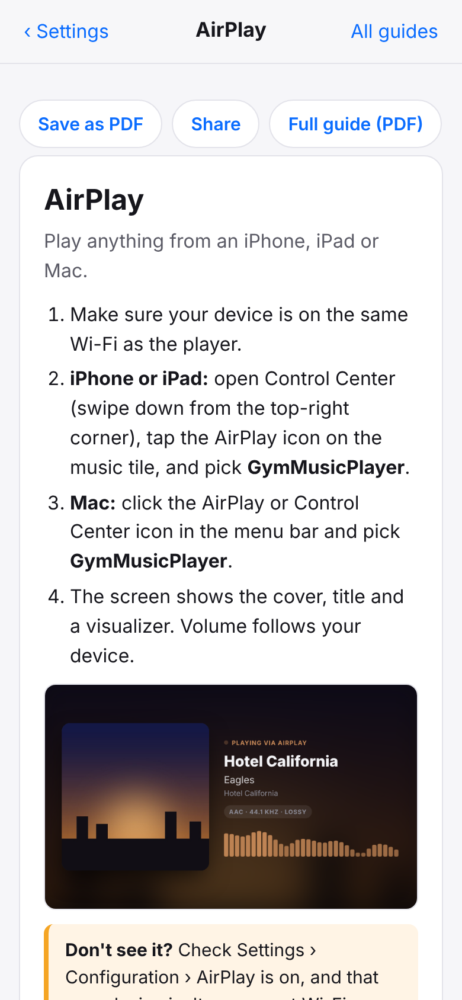
</p>

- **Configuration:** every app in one list (Plexamp, Apple Music, AirPlay, Spotify, Bluetooth, Music Assistant, Caldera Music, Home Assistant, Workout timer), each with its on/off switch, account status and sign-out, its own options, and a **Setup instructions** link. PlexPie never stores your passwords; each service signs in on its own page.
- **Screen:** sleep, brightness, rotation (follows the Pi desktop, or pick one: handy for the portrait Pi Touch Display 2), show what's playing, swipe home, album-art colors, visualizer, night dimming, light sensor.
- **Sound:** the equalizer, with a live curve of what it does.
- **Network:** Wi-Fi on/off, current network, scan and join (the password goes to NetworkManager, not PlexPie).
- **Updates:** **PlexPie** and **Raspberry Pi OS** are separate rows. **Check now** looks in the background; when something's found the button becomes **Update**, with a list of what's new, and a live progress bar (step, package and elapsed time) while it installs. Raspberry Pi OS asks for a restart only when it needs one. Both check by themselves twice a day, and Home Assistant gets two update entities with Install buttons.
- **Remote access:** the address, a QR code to scan, the PIN, and the list of **registered devices** (e.g. "iPad · Safari, last used today") with **Sign out** for each.
- **Backup:** on the screen, scan the QR code to download the backup on your phone, tablet or computer; restore from the same page.
- **Setup guides:** step-by-step instructions with pictures for every app; **Send the guides to a device** by QR code, then save as PDF, share or print.
- **System:** exit to the Raspberry Pi desktop or command line until the next restart (Back to PlexPie icon, or type `plexpie`), screen sharing (see and use the player's screen from a Mac, iPad or iPhone, password = your PIN), power-cut protection, restart, reboot, shut down.

From another device, only Settings and the guides are reachable, and only with the PIN. Five wrong tries pause logins for a minute. A device stays signed in for a year (renewed each visit); **New PIN** signs every device out.

To keep it on your home screen: open the page, then **Share → Add to Home Screen** (iPhone) or **⋮ → Add to Home screen** (Android). It opens like an app.

## Change settings, update, uninstall

| | |
|---|---|
| Change your answers | The Settings page, or `bash ~/plexpie/configure.sh && sudo bash ~/plexpie/install.sh` |
| Update to the latest version | `cd ~/plexpie && git pull && sudo bash install.sh` |
| Undo everything | `sudo bash ~/plexpie/rollback.sh`, then reboot |

All settings live in `~/plexpie/plexpie.conf`, with a comment on each line. That file holds
your MQTT password, so it's never committed to git. A few you might want:

| Setting | What it does |
|---|---|
| `SCREEN_OFF_AFTER_SECS` | Idle time before the screen sleeps (`0` = never) |
| `AUTO_SHOW_SOURCES` | Which sources bring their app to the screen when they start |
| `APPLE_MUSIC_ZOOM` | Apple Music zoom in percent (`100` = normal) |
| `DAC_MATCH` | Which audio device to prefer (default: any USB DAC) |
| `CHROMIUM_SCALE` | Zoom for all apps, for screens that aren't 800×480 |
| `SWIPE_HOME`, `TOUCH_ROTATE` | Edge swipes to go home; rotation if the screen is mounted rotated |
| `POWER_BUTTON` | `yes` if you wire a push button to pins 5 and 6: press to shut down, press again to start |
| `KNOB`, `KNOB_STEP` | `yes` if you wire a rotary knob ([wiring](docs/gpio.svg)); volume change per click |

## Home Assistant

With MQTT set up, the Pi appears automatically under **Settings → Devices** with these entities:

- **Source:** what's on the screen. Change it to switch apps.
- **Now playing:** source, title, artist, album, and the AirPlay format.
- **Playing:** a binary sensor.
- **Screen:** an on/off switch, plus **Screen brightness**.
- **Volume.**
- **Buttons:** **Pause all**, **Restart screen**, **Reboot**, **Shut down**.
- **Sleep timer:** minutes left; set a number to start it, 0 to cancel.
- **Ambient light:** send a light sensor's lux here (and turn on **Follow a light sensor**) to set the screen brightness automatically:

  ```yaml
  triggers:
    - trigger: state
      entity_id: sensor.<your_room>_illuminance
  actions:
    - action: number.set_value
      target:
        entity_id: number.<your_pi>_ambient_light
      data:
        value: "{{ trigger.to_state.state | float(0) }}"
  ```
- **AirPlay artwork:** an image entity.
- **Diagnostics:** CPU temperature, and whether Music Assistant is reachable.
- **Screen alert:** a notify entity that puts a message on the screen with a chime.
- **Launcher buttons:** one switch per name in **Settings → Home Assistant → Launcher buttons** (for example `Gym lights`). Tapping the button flips the switch; your automations do the rest, and can flip it back to keep it in sync.

### Screen alerts (doorbell, timers, anything)

Publish to `plexpie/<hostname>/alert/set` to show a message for a while, with a chime, over whatever is playing (music keeps playing and isn't paused). A picture can be any URL, or a Home Assistant camera:

```yaml
action: mqtt.publish
data:
  topic: plexpie/szplexpie/alert/set
  payload: >
    {{ {"title": "Front door", "message": "Someone is at the door", "seconds": 30,
        "image": state_attr("camera.front_door", "entity_picture")} | tojson }}
```

`image` paths starting with `/` are loaded from Home Assistant (`HA_URL`, or `http://HA_HOST:8123`). Tap the alert to close it; it goes back to the app that was on screen.

Example: turn your amplifier on when anything plays.

```yaml
triggers:
  - trigger: state
    entity_id: binary_sensor.<your_pi>_playing
    to: "on"
actions:
  - action: media_player.turn_on
    target:
      entity_id: media_player.<your_amplifier>
```

For full Plexamp transport control in Home Assistant, also add the official **Plex** integration.

## Music Assistant

In Music Assistant, open **Settings → Providers** and enable the **Squeezelite** player
provider. Your Pi then shows up as a player under the name you chose. If MA runs on a
different subnet from the Pi, set its address in the wizard. When MA is off, its tile greys
out, and the Pi reconnects by itself when MA comes back.

## Caldera Music

[Caldera Music](https://caldera.homes/music/headless/) is a free, lightweight Plex player from Plex Labs
that plays in sync across rooms. Answer yes to **Add Caldera Music** in `configure.sh`; the installer runs
Caldera's own installer and asks you to sign in to Plex once. The Pi then shows up in Plexamp's speaker list
twice: **YourPlayer** (Plexamp on the screen) and **YourPlayer (Caldera)** for multi-room. When Caldera
plays, the screen shows *Playing via Caldera*, and Pause all and the volume work as usual.

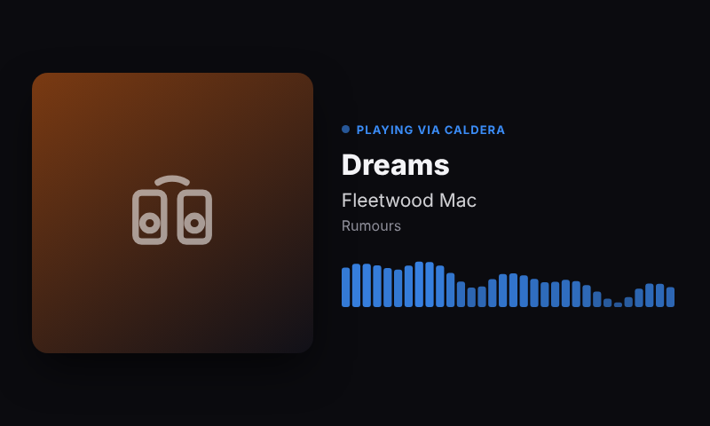

By default PlexPie points Caldera at the shared sound output so it doesn't lock the other apps out of the
DAC. `CALDERA_DEVICE="caldera"` in plexpie.conf lets Caldera pick its own output instead (often the DAC directly,
bit-perfect, but then it's the only app that can play while it's running). Update Caldera with
`UPDATE_CALDERA=1 sudo -E bash install.sh`. Caldera is a Plex Labs project, so it's new and still changing;
support for it is on the [Plex forums](https://forums.plex.tv/c/plex-labs/16).

## Good to know

- **Spotify Connect** uses an unofficial protocol: if Spotify changes something, it may stop working until go-librespot is updated (`UPDATE_SPOTIFY=1 sudo -E bash install.sh`). Quality is up to 320 kbps.
- **AirPlay from Apple Music is lossy** (AAC, about 256 kbps), even when your phone shows
  "Lossless". The iPhone converts the stream before sending it, and the AirPlay screen shows
  the actual format. For lossless, use Plexamp with your own FLAC files.
- **The Apple Music web player** needs Widevine. Raspberry Pi OS includes it; plain Debian doesn't.
- **AirPlay doesn't show up on your iPhone, iPad or Mac?** It and the Pi are probably on different
  subnets. Enable an mDNS repeater (Avahi) on your router.

## Troubleshooting

**Something not working?** The [troubleshooting guide](docs/TROUBLESHOOTING.md) lists real problems and their fixes in plain English: a cut-off or blank screen, Plexamp spinning (often the router blocking `plex.direct`), updates that don't finish, Bluetooth, Home Assistant, router settings and connecting with `ssh`. The player has a short version under Settings › Setup guides › Troubleshooting.

For a read-only report from another computer: `curl -fsSL https://raw.githubusercontent.com/ROGUEONE-SZ/plexamp-raspberry-pi-install/main/tools/diag.sh | ssh USER@PI-ADDRESS bash`

| Problem | Where to look |
|---|---|
| Full report (services, audio, logs, test tone) | `bash ~/plexpie/tools/diagnose.sh` |
| Launcher, screen or Home Assistant | `journalctl -u plexpie -f` |
| Chromium, keyboard | `~/.local/state/plexpie/session.log` |
| Swipe home doesn't work | `journalctl -u plexpie \| grep -i touch` (set `TOUCH_ROTATE` if your screen is mounted rotated) |
| AirPlay | `journalctl -u plexpie-airplay -f` |
| Music Assistant player | `journalctl -u plexpie-squeezelite -f` |
| Spotify Connect | `journalctl -u plexpie-spotify -f` |
| Caldera Music | `journalctl -u plexpie-caldera -f` |
| Updates | `/var/log/plexpie-update.log` |
| Plexamp | `journalctl -u plexamp -f` |
| Audio devices | `wpctl status` |
| Plexamp keeps spinning | Remove `~/.local/share/Plexamp/Settings/%40Plexamp%3Adiscovery%3Ahubs` and run `sudo systemctl restart plexamp` |
| Plex servers unreachable behind pfSense/OPNsense | DNS rebinding protection: allow `plex.direct` (`private-domain: "plex.direct"` in the DNS Resolver) |

## How it fits together

```
get.sh / configure.sh / install.sh / rollback.sh
files/plexpied.py           control daemon: launcher API, app tabs, swipe home, screen, auto-pause, Home Assistant
files/plexpie-overlay.py    on-screen keyboard and touch-to-wake
files/plexpie-session       X session: overlay + Chromium kiosk
files/www/                  launcher, now-playing (AirPlay/Spotify) and Settings screens
files/systemd/              services (plexpie, AirPlay, Spotify, Squeezelite, Plexamp)
files/audio/                PipeWire/ALSA: every source shares the DAC
files/shairport-sync.conf   AirPlay receiver settings
tools/diagnose.sh           read-only troubleshooting report
```

PlexPie glues together other people's excellent work:
[Plexamp](https://www.plex.tv/plexamp/),
[shairport-sync](https://github.com/mikebrady/shairport-sync) and nqptp,
[Squeezelite](https://github.com/ralph-irving/squeezelite),
[go-librespot](https://github.com/devgianlu/go-librespot),
[Music Assistant](https://music-assistant.io), PipeWire and Chromium.
Plexamp, Apple Music, AirPlay and Spotify are trademarks of their owners; this project isn't
affiliated with Plex, Apple or Spotify.

## Credits

PlexPie is the glue; these projects do the heavy lifting. Each is installed from its official source
and keeps its own license and terms:

- [Plexamp](https://www.plex.tv/plexamp/) (headless) by Plex, downloaded from Plex during install
- [shairport-sync](https://github.com/mikebrady/shairport-sync) and [nqptp](https://github.com/mikebrady/nqptp) by Mike Brady, for AirPlay 2
- [go-librespot](https://github.com/devgianlu/go-librespot), an unofficial Spotify Connect client
- [Squeezelite](https://github.com/ralph-irving/squeezelite) and [Music Assistant](https://music-assistant.io)
- [Caldera Music](https://caldera.homes/music/headless/) by Plex Labs (optional), downloaded from Caldera during install
- [PipeWire](https://pipewire.org), WirePlumber, [BlueZ](https://www.bluez.org), Chromium and Raspberry Pi OS
- [QR Code Generator](https://github.com/kazuhikoarase/qrcode-generator) by Kazuhiko Arase (MIT), included in `files/www/qrcode.js`
- Ideas and inspiration from years of Raspberry Pi audio projects, including Volumio, moOde and the
  headless-Plexamp installers that came before

Plexamp, AirPlay, Spotify and Apple Music are trademarks of their owners. PlexPie isn't affiliated with or
endorsed by any of them.

## License

**Free for personal, non-commercial use** under the [PolyForm Noncommercial License 1.0.0](LICENSE.md):
use it at home, change it, share it with friends, learn from it. The license covers PlexPie's own code
only, not the projects it installs.

**Commercial use is not allowed without permission.** That includes selling devices or kits
with PlexPie on them, offering it as a paid service, or building it into a product. If you'd
like to do that, start a [Discussion](https://github.com/ROGUEONE-SZ/plexamp-raspberry-pi-install/discussions)
titled "Commercial license".

Contributions are welcome under the terms in [CONTRIBUTING](CONTRIBUTING.md). Security problems:
see [SECURITY](SECURITY.md).
