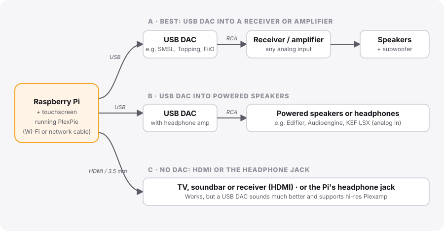
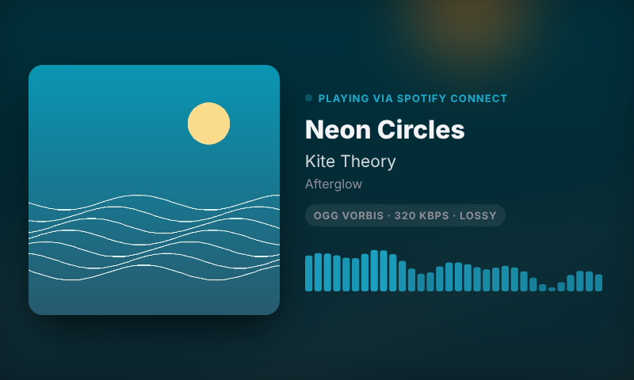
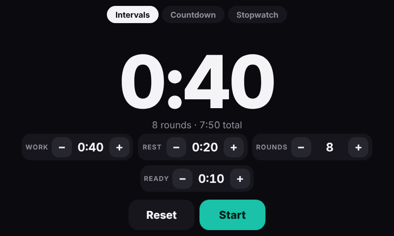
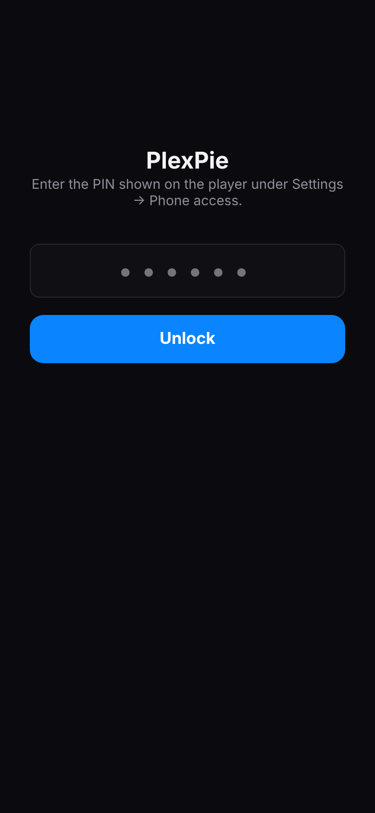

# Build your own PlexPie: step-by-step guide

This guide takes you from an empty box of parts to a working music player, one step at a time.
You don't need to know Linux. You will copy and paste a few commands, and every one is written out
for you. Plan on about **an hour**: 15 minutes of setup, then 15 to 30 minutes of the Pi installing
things on its own.


**Contents**

1. [What you need](#1-what-you-need)
2. [Connect the hardware](#2-connect-the-hardware)
3. [Put Raspberry Pi OS on the memory card](#3-put-raspberry-pi-os-on-the-memory-card)
4. [Start the Pi and connect to it from your computer](#4-start-the-pi-and-connect-to-it-from-your-computer)
5. [Install PlexPie](#5-install-plexpie)
6. [Link Plexamp to your Plex account](#6-link-plexamp-to-your-plex-account)
7. [First use: play some music](#7-first-use-play-some-music)
8. [Set up your receiver or speakers](#8-set-up-your-receiver-or-speakers)
9. [Settings, also from your phone](#9-settings-also-from-your-phone)
10. [Optional: Home Assistant](#10-optional-home-assistant)
11. [Updating and uninstalling](#11-updating-and-uninstalling)
12. [Something's not working?](#12-somethings-not-working)

---

## 1. What you need

| Part | What to get | Notes |
|---|---|---|
| **Raspberry Pi** | Raspberry Pi 4 (2 GB or more) or Raspberry Pi 5 | A Pi 4 with 4 GB is plenty |
| **Power supply** | The official Raspberry Pi USB-C power supply for your model | Cheap phone chargers cause random freezes |
| **Memory card** | microSD card, 32 GB or larger, "A1" or "A2" rated | SanDisk or Samsung are reliable |
| **Touchscreen** | The official Raspberry Pi 7" Touch Display, or any HDMI touchscreen | Any size works; the screen adapts |
| **Case** | A case that holds your Pi and screen together | Optional, but it makes it look like a real device |
| **Audio** | A **USB DAC** (recommended), or use HDMI / the headphone jack | See [section 2](#2-connect-the-hardware) |
| **Cables** | An RCA cable (DAC to receiver) or 3.5 mm cable (DAC to powered speakers) | Most DACs come with a USB cable |
| **A computer** | Mac, Windows or Linux, with a microSD card reader | Only for setup |
| **Accounts** | Plex (free) for Plexamp. Optional: Apple Music, Spotify Premium, Home Assistant | You can add these later |

> **What's a DAC?** A small box that turns digital music into the analog signal your amplifier or
> speakers understand. The Pi's own headphone jack works, but a USB DAC (from about $50, e.g. SMSL,
> Topping or FiiO) sounds far better and plays lossless and hi-res music from Plexamp at full quality.

## 2. Connect the hardware

Do this with the power **unplugged**.

1. **Screen.** For the official 7" display, connect its ribbon cable to the Pi's "DISPLAY" connector
   and its power wires to the Pi's pins, as shown in the screen's leaflet. For an HDMI touchscreen,
   connect HDMI to the Pi's HDMI port (the one next to the power port) and the screen's USB cable to
   the Pi, which is how touch works.
2. **Network.** A network cable from your router to the Pi is the most reliable. Wi-Fi works too;
   you set it up in step 3.
3. **Audio.** Pick one of these three setups:



- **A. USB DAC into a receiver or amplifier (best).** USB cable from the Pi to the DAC. RCA cable
  from the DAC's output to any analog input on your receiver (often labelled CD, AUX, TAPE or
  similar). Your receiver powers the speakers and subwoofer as usual.
- **B. USB DAC into powered speakers.** Same as A, but the DAC's output goes straight into powered
  speakers (speakers with their own power cable and volume knob), or plug headphones into the DAC.
- **C. No DAC.** Use the Pi's HDMI into a TV, soundbar or receiver, or the Pi's 3.5 mm headphone
  jack into powered speakers.

PlexPie finds a USB DAC by itself; you don't need to configure anything.

Don't plug in the power yet.

## 3. Put Raspberry Pi OS on the memory card

1. On your computer, download and install **Raspberry Pi Imager** from
   [raspberrypi.com/software](https://www.raspberrypi.com/software/).
2. Put the microSD card in your computer and open Raspberry Pi Imager.
3. **Choose Device:** pick your Pi (Raspberry Pi 4 or 5).
4. **Choose OS:** pick **Raspberry Pi OS (64-bit)**. Either the normal version or "Lite" (under
   *Raspberry Pi OS (other)*) works; Lite starts faster.
5. **Choose Storage:** pick your microSD card. Double-check it's the card, not another drive.
6. Click **Next**. When it asks *"Would you like to apply OS customisation settings?"*, click
   **Edit Settings** and fill in:
   - **Hostname:** a name for your player, for example `plexpie`.
   - **Username and password:** choose a username (for example `pi`) and a password. Write them down.
   - **Wireless LAN:** your Wi-Fi name and password, if you're not using a network cable. Set the
     country to where you live.
   - **Locale settings:** your time zone and keyboard.
   - **Services** tab: turn on **Enable SSH** and choose **Use password authentication**.
7. Click **Save**, then **Yes** to apply the settings, then **Yes** to write the card.
   It takes a few minutes.
8. When it says it's finished, take the card out and put it in the Pi (the slot is underneath).

## 4. Start the Pi and connect to it from your computer

1. Plug in the Pi's power. The screen shows the Pi starting up. The first start takes 2 to 3
   minutes while it sets itself up; it may restart once by itself.
2. On your computer, open a terminal:
   - **Mac:** press <kbd>⌘ Command</kbd> + <kbd>Space</kbd>, type `Terminal`, press <kbd>Enter</kbd>.
   - **Windows:** press <kbd>Start</kbd>, type `PowerShell`, press <kbd>Enter</kbd>.
3. Type this, using the username and hostname you chose in step 3, and press <kbd>Enter</kbd>:

   ```bash
   ssh pi@plexpie.local
   ```

4. The first time, it asks *"Are you sure you want to continue connecting?"*. Type `yes` and press
   <kbd>Enter</kbd>. Then type your Pi's password (nothing appears while you type, that's normal)
   and press <kbd>Enter</kbd>.
5. You're in when you see something like `pi@plexpie:~ $`.

> **"Could not resolve hostname"?** Use the Pi's address instead of `plexpie.local`. Find it in your
> router's list of connected devices (look for "plexpie"), then run `ssh pi@192.168.1.42` with that
> address.

## 5. Install PlexPie

Still in the terminal connected to the Pi, copy this whole line, paste it, and press <kbd>Enter</kbd>:

```bash
curl -fsSL https://raw.githubusercontent.com/ROGUEONE-SZ/plexamp-raspberry-pi-install/main/get.sh | bash
```

A short setup wizard asks a few questions. Press <kbd>Enter</kbd> to accept the suggested answer
shown in brackets, or type your own:

| Question | What to answer |
|---|---|
| Linux user that runs the screen | Press Enter (your username) |
| Player name | What you'll see in Plexamp and AirPlay, e.g. `Living Room` |
| Add an AirPlay 2 receiver? | `yes` if you have an iPhone, iPad or Mac |
| Add the Apple Music web player? | `yes` if you have Apple Music |
| Add a Spotify Connect receiver? | `yes` if you have Spotify Premium |
| Add Music Assistant? | `no`, unless you already run a Music Assistant server |
| Connect to Home Assistant? | `no`, unless you use Home Assistant (you can add it later) |
| Turn the screen off after how many idle seconds? | `60` is a good start |

Then it installs everything by itself. It may ask for your Pi's password once. Expect **15 to 30
minutes**; building AirPlay takes the longest. You can leave it running.

## 6. Link Plexamp to your Plex account

Partway through, the installer stops and asks for a **claim code**:

1. On your phone or computer, open [plex.tv/claim](https://plex.tv/claim) and sign in to Plex.
2. Copy the code it shows (it starts with `claim-`).
3. Paste it into the terminal and press <kbd>Enter</kbd>. The code expires after a few minutes, so
   do this right away.
4. When it asks for a player name, type the same name you gave in the wizard and press <kbd>Enter</kbd>.
5. When Plexamp says it's ready, press <kbd>Ctrl</kbd> + <kbd>C</kbd>. The installer carries on.

When the installer finishes, the touchscreen restarts and shows the PlexPie home screen.
You can close the terminal.

## 7. First use: play some music

 

The home screen has a tile for each music app. Tap one to open it. To come back to the home screen
from any app, **swipe right from the left edge** of the screen, or **swipe down from the top edge**.

- **Plexamp:** tap the tile and pick your Plex server, then play anything. You can also control it
  from the Plexamp app on your phone: choose your player name as the playback device.
- **AirPlay:** on your iPhone, open Control Center, tap the AirPlay icon in the music controls and
  choose your player name. The screen shows the cover, song and stream quality.
- **Spotify:** in the Spotify app, tap the speaker icon and choose your player name.
- **Apple Music:** tap the tile and sign in to Apple Music on the screen. A keyboard slides up when
  you tap a text box.
- **Timer:** an interval timer for workouts, plus countdown and stopwatch. Big numbers and beeps,
  and the screen stays on while it runs.

 

Good to know:

- **One thing plays at a time.** Starting music from one app pauses the others, and the screen
  switches to the app that's playing.
- **The screen sleeps** when nothing is playing. The first tap only wakes it, so you don't press
  anything by accident.
- **Volume:** use the − and + buttons on the home screen, or your receiver's knob.

## 8. Set up your receiver or speakers

**With a receiver or amplifier (setup A):**

1. Switch the receiver to the input you plugged the DAC into (for example CD or AUX).
2. Leave PlexPie's volume at 100 and use the receiver's volume knob. That gives the best sound.
3. Start with the receiver turned down, play something, then turn it up slowly.
4. Optional: many receivers can be renamed per input ("PlexPie" instead of "CD"), and many can
   switch themselves on with network control. Home Assistant can then turn the receiver on when music
   starts and off when it stops; see [section 10](#10-optional-home-assistant).

**With powered speakers (setup B):** set the speakers' own volume to about halfway, and use
PlexPie's − and + buttons for everyday volume.

**With HDMI or the headphone jack (setup C):** without a USB DAC, PlexPie plays through the Pi's
default output. If the sound comes out of the wrong one, connect to the Pi (step 4), run
`wpctl status`, note the number next to the output you want under "Sinks", and run
`wpctl set-default <number>`.

**A subwoofer that never turns off?** Plug it into a smart plug and let Home Assistant switch it
with the receiver.

## 9. Settings, also from your phone

Tap the **gear** at the top right of the home screen.


Here you can:

- turn apps on and off (they disappear from the home screen),
- see which accounts are signed in,
- set the screen brightness and sleep time,
- join a Wi-Fi network, or turn Wi-Fi off,
- install updates with one button,
- connect Home Assistant and add home-screen buttons for it.

**From your phone:** under **Phone access**, Settings shows an address like
`http://192.168.1.42:8080/settings` and a **PIN**. Open that address on your phone (on the same
Wi-Fi) and type the PIN once. Your phone stays signed in.

 

To keep it on your home screen like an app: **Share → Add to Home Screen** on iPhone, or
**⋮ → Add to Home screen** on Android.

## 10. Optional: Home Assistant

If you use [Home Assistant](https://www.home-assistant.io) with the Mosquitto broker app, enter the
broker's address, username and password in **Settings → Home Assistant**. The player then appears
in Home Assistant by itself, with:

- what's playing, a **Playing** sensor, the current app, volume and screen controls,
- **launcher buttons:** type names in **Settings → Home Assistant → Launcher buttons** (for example
  `Lights`). Each becomes a button on the home screen and a switch in Home Assistant, so a tap can
  run any automation,
- **screen alerts:** show a message and a camera picture on the screen with a chime, for example
  when the doorbell rings. Music keeps playing.


Ideas: turn the receiver and subwoofer on when **Playing** turns on and off a few minutes after it
turns off; turn on the room lights from a launcher button; show the front-door camera when someone
rings. The [main README](../README.md#home-assistant) has the details and examples.

## 11. Updating and uninstalling

- **Update:** **Settings → Updates → Update now**. It installs Raspberry Pi OS updates and the newest
  PlexPie together, with a progress bar, and tells you if a restart is needed. It also checks by
  itself twice a day.
- **Change your wizard answers:** connect to the Pi (step 4) and run
  `bash ~/plexpie/configure.sh && sudo bash ~/plexpie/install.sh`.
- **Turn it off:** **Settings → System → Shut down**. Wait about 15 seconds, until the green light on
  the Pi stops blinking, then unplug it. (Some screens stay lit after the Pi is off; that's normal.) Plug it back in to start it. Don't just pull the plug while
  it's running: that can damage the memory card.
- **Want a real power button?** Wire a small push button to pins 5 and 6 of the Pi (the third pair
  of pins from the end nearest the memory card), set `POWER_BUTTON="yes"` in `~/plexpie/plexpie.conf`, run
  `sudo bash ~/plexpie/install.sh` and reboot. Press it to shut down, press again to start.
- **Uninstall:** run `sudo bash ~/plexpie/rollback.sh`, then `sudo reboot`. The Pi goes back to how
  it was before PlexPie.

## 12. Something's not working?

| Problem | Try this |
|---|---|
| No sound | Check the receiver's input and volume. In Settings, make sure the app is on. Then run `bash ~/plexpie/tools/diagnose.sh`, which also plays a test tone |
| AirPlay or Spotify doesn't show the player | Phone and Pi must be on the same network. Some routers block this between Wi-Fi and wired devices; turn on "mDNS" or "Bonjour" forwarding in the router |
| The screen is upside down or touches land in the wrong place | Set `TOUCH_ROTATE` in `~/plexpie/plexpie.conf`, then run `sudo bash ~/plexpie/install.sh` |
| Plexamp keeps spinning | Settings → System → **Restart PlexPie** |
| Can't find the phone address | It's in Settings → Phone access on the player |
| The screen is black | Tap it: it's probably asleep. Still black? Unplug the power for 10 seconds |
| Anything else | Run `bash ~/plexpie/tools/diagnose.sh` and [open an issue](https://github.com/ROGUEONE-SZ/plexamp-raspberry-pi-install/issues) with its output |

---

PlexPie is free for personal, non-commercial use. See the [license](../LICENSE.md).
